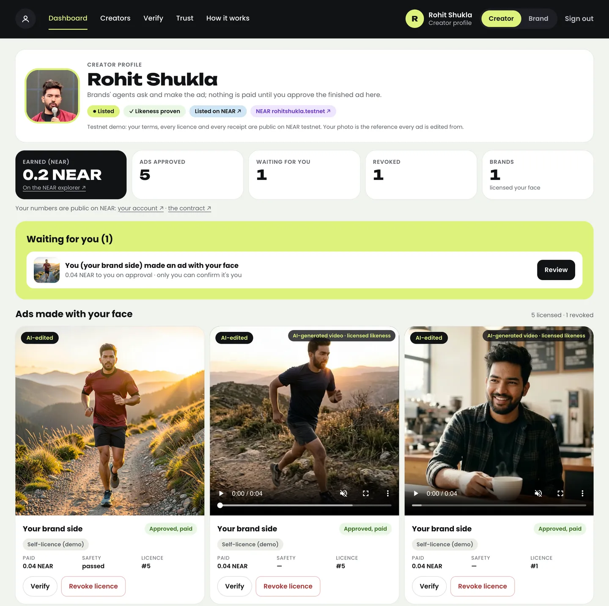
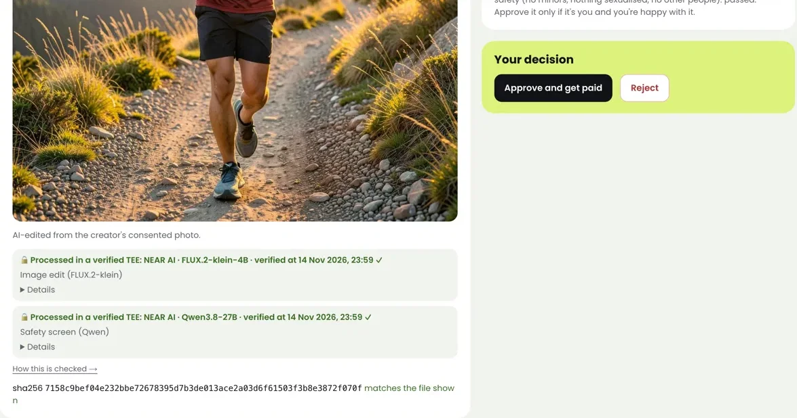
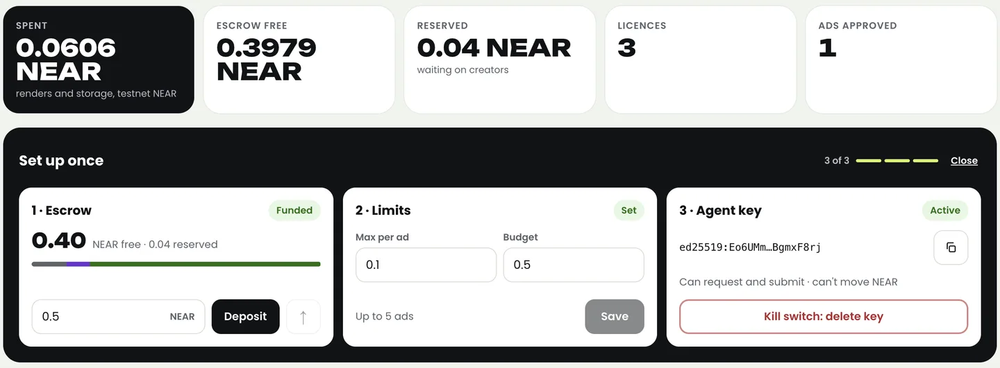
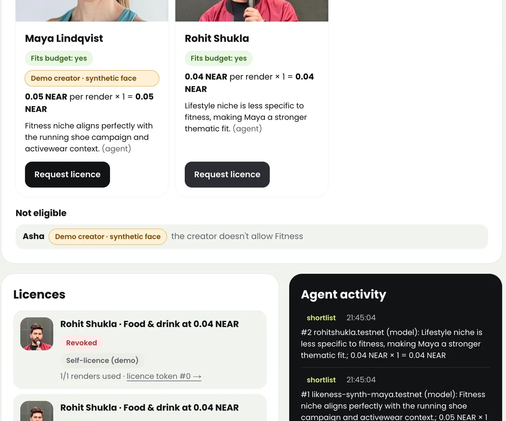
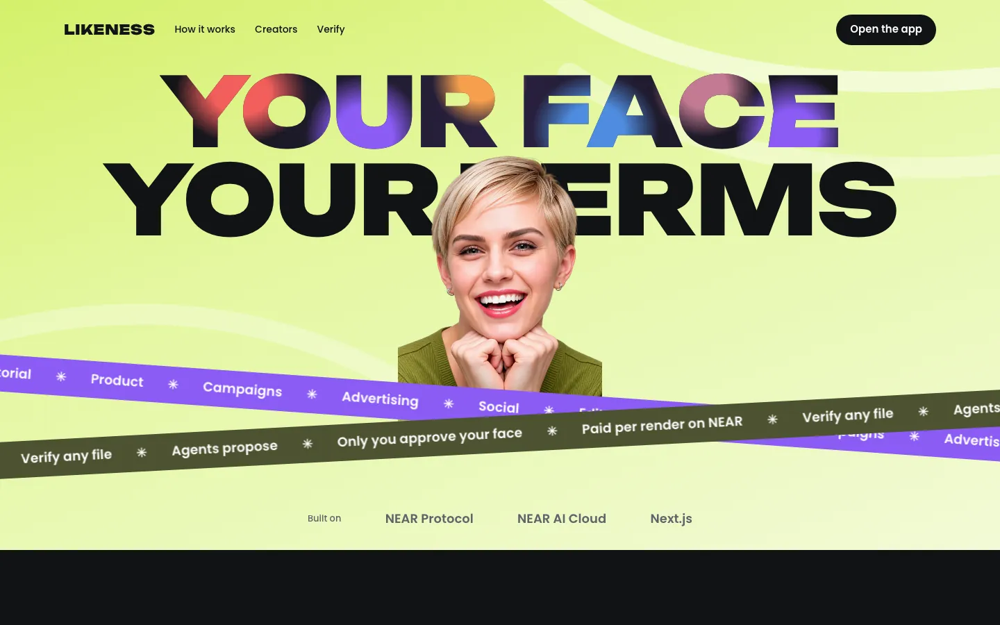

# Likeness

[](https://github.com/rohitshukla11/likeness-near/actions/workflows/ci.yml)

A brand's AI agent licenses a real creator's face for ads; the creator approves every licence and every ad and is paid
per approved ad from the brand's escrow on NEAR. Anyone can verify an ad: Licensed, Expired, Revoked or Unknown.

**Live demo (NEAR testnet):** https://likenesss.onrender.com · **Tracks:** `nfts`, `security`, `business`, `open`,
`privacy`, `agents`

## For judges

**(a) No wallet, no install:**

| Open | You see |
|---|---|
| [Verify: Licensed example](https://likenesss.onrender.com/verify?sha256=7158c9bef04e232bbe72678395d7b3de013ace2a03d6f61503f3b8e3872f070f) | **Licensed**, Licence NFT #5, **🔒 AI processing: verified TEE (NEAR AI)** |
| [Verify: Revoked example](https://likenesss.onrender.com/verify?sha256=cb3c711510d2280036121a4df1de7bea7a4f7f2739877e568226c029e6b2ff9a) | **Revoked**: approved and paid, then revoked by the creator |
| [`/licence/5`](https://likenesss.onrender.com/licence/5), [`/licence/0`](https://likenesss.onrender.com/licence/0) | The licence NFT drawn by the contract (ACTIVE / REVOKED), its money and transactions |
| [`/trust`](https://likenesss.onrender.com/trust) | NEAR AI's TEE attestation for both models, verified live; raw report download |
| [`/creators`](https://likenesss.onrender.com/creators) | The creators and their on-chain terms |

**(b) Tests, no keys, no `.env`** (the install needs the network; the tests run offline). Same as
[CI](https://github.com/rohitshukla11/likeness-near/actions/workflows/ci.yml):

```sh
pnpm -C web install --frozen-lockfile
pnpm -C web test                 # 50 tests (TEE checks on a saved real report)
(cd contract && cargo test)      # 70 tests
```

`pnpm -C web build` needs no keys but downloads web fonts (network).

**(c) Full app locally:** needs a Neon database, a NEAR AI key and a testnet agent key: [Run it locally](#run-it-locally).

**(d) With a NEAR testnet wallet** (e.g. Meteor): sign in → you're a brand → **Find creators** → the agent's shortlist
with reasons (demo mode, nothing on-chain). The full licence → ad → payment flow runs only for the brand holding the
server's agent key: see the demo video and [Proof it's live](#proof-its-live).

## Screenshots

| | |
|---|---|
|  The creator's dashboard: earnings and counts (public on NEAR), the ad waiting for approval, and the ads (images and videos) made with their face, each with its licence |  The creator's review page: both models **🔒 verified in a TEE**; nothing is paid until the creator approves |
|  Escrow, limits, and an agent key that **can't move NEAR** |  The agent's shortlist with reasons, and who isn't eligible |
|  `/trust`: FLUX.2-klein and Qwen **TEE verified** |  The hosted app |

## Problem

- **Brands:** creator content doesn't scale; shoots are slow and costly; AI ads without the person's consent are a legal
  and reputational risk.
- **Creators:** income is capped by their time; paid likeness licensing reaches only the top 1%.

## What Likeness does

- **On-chain terms:** price per render, allowed uses, render cap, longest licence.
- **An agent that can't move funds:** a function-call key limited to `request_licence` and `submit_render`.
- **Approval of every ad:** the creator approves the licence, then each ad by its sha256, in their own wallet.
- **Escrow pays only on approval** of that exact file.
- **Licence NFTs:** non-transferable NEP-171 tokens whose image the contract draws from live state.
- **Verify:** hash a file in the browser, ask the contract.

## How to test (hosted site)

1. **Verify → Licensed example** → Licensed, NFT #5, "🔒 AI processing: verified TEE (NEAR AI)".
2. **Licence token #5 →** → green **ACTIVE** card, "Paid to creator: 0.08 NEAR", history with **🔒 TEE verified**.
3. **Verify → Revoked example** → Revoked → **Licence token #0 →** → red **REVOKED** card.
4. **Trust** → both models **TEE verified**, each check listed.
5. **Creators** → creators and their on-chain terms.
6. Drop any image on **Verify** → hashed in the browser, never uploaded → **Unknown**.
7. With a testnet wallet: **Connect NEAR wallet** → sign a message (NEP-413, no transaction) → **Dashboard** → the
   brief is prefilled (a trail runner, Fitness) → **Find creators** → shortlist with reasons and a "Not eligible" list.

Creators: the author, `rohitshukla.testnet`, is the one real creator (his photo, published with his consent); Asha and
Maya Lindqvist are synthetic (AI-generated faces, badged everywhere). The author's account is also a brand; a licence it
grants itself is labelled **Self-licence (demo)** and still needs his approval in his own wallet.

## Proof it's live

Every hash below was checked on NEAR testnet (14–15 Nov 2026).

| What | On-chain |
|---|---|
| Contract | [`likeness-near-rohit.testnet`](https://testnet.nearblocks.io/address/likeness-near-rohit.testnet), code hash `AggUALRhRf7kSK4c44J5ZXa74knNSrbeJtaJQxSGTnnJ` |
| Reproducible build | A fresh-clone contract build reproduces the deployed code hash `AggUALRhRf7k…` (same toolchain, `rust-toolchain.toml`; `contract/scripts/build.sh`). |
| Licence-NFT upgrade (code-only, state kept) | [`9bxx1Pf6…`](https://testnet.nearblocks.io/txns/9bxx1Pf64VTXMRLSmMHv1mb4VtRa9U7BvRvm2xGxqWL5) |
| A TEE-verified ad, approved and paid | [`7158c9be…`](https://likenesss.onrender.com/verify?sha256=7158c9bef04e232bbe72678395d7b3de013ace2a03d6f61503f3b8e3872f070f) on [`/licence/5`](https://likenesss.onrender.com/licence/5): `submit_render` [`DixBQ81Q…`](https://testnet.nearblocks.io/txns/DixBQ81QrtUkzop1rXupBKV9nHo75RNrxJYt2wCyFjAU), `approve_render` [`FwD8eaMr…`](https://testnet.nearblocks.io/txns/FwD8eaMrwzwrnstXuDqC1zxWYBpFTxqsp6BisTdbsEoZ) |
| A paid `approve_render` (0.04 NEAR) | [`87bdJZEp…`](https://testnet.nearblocks.io/txns/87bdJZEp4gmLaW4KRYatgfsG4TTGAgEmkGmwhX5YRsrd) |
| A `revoke_licence` (licence 0) | [`7VRgDYFx…`](https://testnet.nearblocks.io/txns/7VRgDYFxbbS3ihfXTnFKJYZWZCRKc7wVb1uiZUueQKJ7) |
| Verify | Licensed: [`7158c9be…`](https://likenesss.onrender.com/verify?sha256=7158c9bef04e232bbe72678395d7b3de013ace2a03d6f61503f3b8e3872f070f), [`43c05e2c…`](https://likenesss.onrender.com/verify?sha256=43c05e2cf8d2fff9c2b874484b67e1f4aa18c4aced2e43e1425d88848707b6d4); Revoked: [`cb3c7115…`](https://likenesss.onrender.com/verify?sha256=cb3c711510d2280036121a4df1de7bea7a4f7f2739877e568226c029e6b2ff9a) |

## NEAR features used

| Feature | What it does | Code |
|---|---|---|
| Dynamic licence NFT (NEP-171 / 177 / 181) | Non-transferable, owned by the brand; metadata computed on every read: on-chain SVG, status (flips with no write), money | `contract/src/nft.rs:84` (`licence_svg`), `:133` (`token_of`), `:189` (`nft_token`), `:195` (transfer refused), `:226` (metadata), `:244` (enumeration); `contract/src/types.rs:250` (`status_at`); `contract/src/views.rs:129` (`licence_summary`) |
| NFT events | `nft_mint`; NEP-171 v1.2.0 `nft_metadata_update` on approve_licence, approve_render, revoke_licence, release_expired | `contract/src/events.rs:8`, `:14` |
| Function-call agent key + kill switch | Receiver = the contract; `request_licence` and `submit_render` only; 0.25 NEAR gas allowance; no deposits, so it can't move funds; one DeleteKey stops it | `web/lib/near/methods.ts:60-62`; `web/components/brand/AgentKeyCard.tsx:69` |
| Escrow released only on approval of the exact file | `submit_render` reserves the price (per-licence caps, brand limits); only the creator's `approve_render(sha256)` pays | `contract/src/render.rs:12` (`submit_render`), `:52` (`approve_render`), `:80` (payout); `contract/src/licence.rs:66` (`approve_licence`), `:105` (`revoke_licence`) |
| Public verify | `verify(sha256)` → Licensed / Expired / Revoked / Unknown, same status function as the token | `contract/src/views.rs:72` |
| NEP-413 sign-in | One-time 32-byte nonce, checked against the account's full-access keys | `web/lib/session.ts:65` |
| NEAR AI Cloud | FLUX.2-klein edits of the creator's photo; Qwen for the brief screen, ranking and safety screen | `web/lib/ai/image.ts:17`, `web/lib/ai/nearai.ts:35`, `web/lib/ai/faceCheck.ts:20`, `web/lib/agent/rank.ts:81` |
| NEAR AI TEE attestation | Before each FLUX edit and Qwen safety screen: fresh nonce, `/v1/attestation/report`, Intel TDX quote to Intel's root CA, `report_data` binding, NVIDIA NRAS; recorded per ad | `web/lib/tee/verify.ts:87` (`verifyTdxQuote`), `:135` (`reportDataBinds`), `:145` (`verifyNras`), `:191` (`verifyAttestation`), `:281` (10-min cache); `web/lib/tee/attestation.ts:29` (fetch + NRAS), `:74` (`attestForRender`); `web/lib/agent/pipeline.ts:55`, `:99` (the hooks); `web/app/api/tee/status/route.ts` (`/trust`) |

## The licence NFT

- **Drawn on-chain.** `nft_token(id).metadata.media` is an SVG the contract draws on every read
  (`contract/src/nft.rs:84`): status badge (ACTIVE green, REVOKED red, EXPIRED / EXHAUSTED grey), creator, brand, use,
  renders used, NEAR paid, expiry. Under 2 KB; `media_hash` = base64(sha256) of that SVG.
- **Status computed on read:** an expired licence reads EXPIRED with no transaction.
- **Non-transferable by design:** it is consent from one creator to one brand.
- **Money:** `extra` and `licence_summary(id)`: price, renders used / waiting / left, paid to the creator, reserved now,
  and what goes back to the brand if it ends now.
- **Events:** `nft_mint`, and `nft_metadata_update` whenever the image changes.
- **Revoked tokens kept as history:** never burned, so `verify(sha256)` still proves an ad was approved under a licence
  later revoked.
- **Added in place:** a code-only redeploy; tests read the real pre-upgrade testnet storage with the new code
  (`contract/src/tests/onchain.rs`).

## Privacy & TEE attestation

Face images are processed by two NEAR AI Cloud models, FLUX.2-klein (ad images) and Qwen (the agent and the safety
screen), and **this app verifies, before using each model, that it runs in a Trusted Execution Environment**: with a
fresh nonce at least every 10 minutes per model, recorded with every ad, shown on the review page, in Verify, in licence
history and on [`/trust`](https://likenesss.onrender.com/trust) (raw report downloadable).

| Check (`web/lib/tee/verify.ts`) | What it proves |
|---|---|
| Fresh nonce | A new 32-byte nonce is echoed back by the model's attestation and NEAR AI's gateway (no replayed report). |
| Intel TDX quote | Signed by its attestation key; the Quoting Enclave report signed by the PCK certificate and binding that key; the PCK chain up to Intel's SGX Root CA, pinned by fingerprint, valid now. |
| Key binding | `report_data` = the model's signing address (32 bytes) + the nonce. |
| NVIDIA GPUs | NRAS verdict true; every token ES384-signed by NVIDIA's published keys, not expired, with our nonce; every GPU's measurements and nonce match, debug off. |

"Processed in a verified TEE" appears only when **every** check passed for both models; otherwise "not verified" names
the failed check. A failed check never blocks an ad, a payment or an approval (20-second limit;
`TEE_ATTESTATION_ENABLED=false` turns checks and labels off). `web/test/tee.test.ts` runs every check on a real saved
report: it passes; a different nonce, one flipped quote byte, an expired or forged NVIDIA token each fail.

**Not verified, or not in a TEE:**

- Intel's TCB status (whether the platform's firmware is up to date or revoked) is not checked.
- Chat-answer signatures (that a given answer was signed by the attested key) are not checked.
- Requests reach the models through NEAR AI's API gateway (its attestation is in the same report; the app checks that it
  echoes the nonce).
- The app server (Render) and the database (Neon) are not TEEs; reference photos and unapproved ads are stored there
  privately.
- Video is made with Google's models, outside any TEE.

| Where | Who can see the face | TEE |
|---|---|---|
| Browser | The signed-in creator and brand; Verify only hashes files locally | No |
| App server (Render) | The server process (forwards photos to the models, stores results) | No |
| Database (Neon) | Stored privately: reference photos and unapproved ads go only to their creator and brand; a Licensed ad becomes public | No |
| NEAR AI Cloud (FLUX.2-klein, Qwen) | The model inside NEAR AI's enclave, via NEAR AI's gateway | **Yes, verified by this app** before each use |
| Video provider (video only) | Google Gemini Omni Flash and the start-frame image model | No |

Safety and identity: Qwen screens each ad: a minor or sexualised content blocks it; other people → one regeneration,
then dropped; no valid answer → asked once more, then dropped (fail closed). No AI identity check gates any payment or is shown as a verdict; the creator's approval is the only identity gate. The video start frame uses an internal face-match retry that only regenerates the frame.

## Why this contract

- **The agent key can't move funds:** two methods, no deposits, a 0.25 NEAR gas allowance; one DeleteKey stops it.
- **Escrow is released only by the creator's approval of the exact sha256;** reject, revoke or expiry release the
  reservation back to the brand.
- **Per-licence caps:** each licence's render cap, use and expiry are checked on every submission, with the brand's
  per-render limit and total budget.
- **Beyond a generic permissions API:** it can limit what an agent spends; it can't make each payment wait for a third
  party (the creator) to approve one exact file, tied to a licence token anyone can verify.

## Known limitations

- **Testnet only.**
- **FLUX likeness drift.** NEAR AI Cloud's only image model, `black-forest-labs/FLUX.2-klein-4B`, doesn't keep the face
  exactly. Tested on 13 Nov 2026 with the author's face: scene-changing edits gave a different face and added people
  even when the prompt forbids them; the same input and prompt return byte-identical images (the seed had no effect);
  the face was kept only when the person was left untouched. So the creator, not an AI, confirms every ad.
- **Video:** Video: start frame and clip made with Google's models from the creator's reference photo (outside NEAR AI); the creator approves every video. On by default for this demo; a per-creator opt-in is on the roadmap.
  Clips may include AI-generated ambient audio. 4 s, 720p, labelled "AI-generated video · licensed likeness"; about
  $0.44 each, refused over $0.50, 3 a day site-wide.
- **One agent key on the hosted demo:** only the brand holding the server's agent key (the author's) runs the full
  agent; other signed-in brands get demo mode.

## Roadmap

- The rest of attestation: Intel TCB status and chat-answer signatures.
- Payouts through NEAR Intents.
- Consent-gated transfer of a licence token.
- A NEAR sub-account per licence, holding its own escrow.
- A per-creator video opt-in.

## Run it locally

Node 22, pnpm 12 (`corepack enable`), Rust (`contract/rust-toolchain.toml`). `web/`: the Next.js app; `contract/`: the
Rust contract (build, test, deploy: `contract/README.md`).

```sh
git clone https://github.com/rohitshukla11/likeness-near && cd likeness-near
pnpm -C web install --frozen-lockfile
cp .env.example web/.env.local   # fill in what you need (below)
pnpm -C web db:migrate           # once, if DATABASE_URL is set
pnpm -C web dev                  # http://localhost:3000
```

What each feature needs:

| Feature | Needs |
|---|---|
| Verify, /creators, /licence/&lt;id&gt; | `NEXT_PUBLIC_CONTRACT_ID`, `NEXT_PUBLIC_NEAR_NETWORK=testnet` |
| Sign-in, dashboards, activity log, licence history | `DATABASE_URL` (Postgres), `SESSION_SECRET` |
| Find creators, ad images, safety screen, TEE attestation | `NEARAI_API_KEY` (`AI_MODE=test`: no model call, labelled rule-based path) |
| Licence requests and ad submissions on-chain | `AGENT_ACCOUNT_ID` + `AGENT_PRIVATE_KEY` (the brand's function-call key) |
| Video (optional) | `VIDEO_ENABLED=true` and the video API key (`.env.example`) |
| Deploying the contract | near-cli-rs and a testnet key in `~/.near-credentials` |

`pnpm -C web secrets:init <brand>.testnet` writes `SESSION_SECRET` and a new agent key into `web/.env.local` and prints
only the public key (the brand adds it with one AddKey). Keys stay in `web/.env.local` and `~/.near-credentials`,
outside git.

## Third-party libraries

Web (`web/package.json`): `next` 16.3.8, `react` / `react-dom` 19.2.8, `@hot-labs/near-connect` 0.12.0, `near-api-js`
7.4.0, `@neondatabase/serverless` 1.2.0; dev: `typescript` 5.9.3, `tailwindcss` / `@tailwindcss/postcss` 4.3.3, `eslint`
9.39.5, `eslint-config-next` 16.3.8, `@types/*`. Contract (`contract/Cargo.toml`): `near-sdk` 5.30.1,
`near-contract-standards` 5.30.1. Services: FastNEAR RPC, NEAR AI Cloud, Neon, Render;
video only: Google Gemini Omni Flash.

**Image sources:** the real creator's photo was supplied by Rohit Shukla and is published with his consent;
`web/public/creators/rohit.jpg` (sha256 `89a4d997…`) is his on-chain reference, a crop of the 800x800 original
`web/public/creators/rohit-card.jpg` (sha256 `0f03b10c…`, shown on creator cards; the video reference). Synthetic
creators: `web/public/synthetic/PROVENANCE.md`. Landing faces (AI-generated, no real person):
`web/public/landing/PROVENANCE.md`.

## License

MIT.
